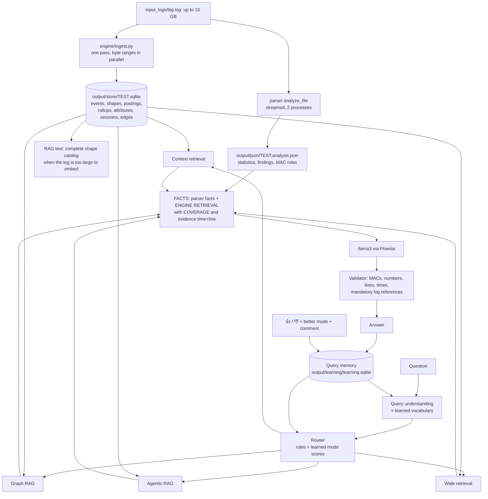

# Hostapd AI Analyzer v4.0 — production engine

**Goal:** analyse hostapd logs of up to 10 GB on a laptop without a GPU, completely (no sampling) and without
hallucination, with every processing step linear in the size of the log.

**Design rule (unchanged since v1):** the language model never counts, searches or guesses. Deterministic code
reads the whole log once, builds an index, and answers each question with exact counts and real log lines. The
model only writes the explanation, and the validator checks it against the log.

---

## 1. Big picture

## 2. Ingest — one pass, linear time, constant memory

`engine/ingest.py` cuts the file into byte ranges of 32 MB at line boundaries. Worker processes (one per CPU core)
each read one range; the parent merges the results **in file order** with at most 2 × workers ranges in flight, so
memory does not grow with the file. Per line (all O(length of the line)):

1. split on `\r\n`, `\n` or a lone `\r` — the same line numbers as Notepad++ / VS Code and the parser;
2. parse the timestamp (logread, syslog, ISO-8601, `hostapd -t`);
3. build the **message shape** (template): MAC → `<M>`, numbers / hex → `#`, hexdump payload dropped;
4. record which 2048-line **block** mentions the shape and every MAC in the line (postings);
5. run the typed-event **rules chosen once per shape** (`engine/rules.py`) — a line whose shape has no rule costs a
   dictionary lookup.

At the end, rollups per minute, sessions (connect → how it ended, with AP-restart attribution) and graph edges are
derived from the event table with single SQL / streaming passes. The raw log is **not copied**: the store keeps the
byte offset of every block, so any line is one seek + one 300 KB read away.

The legacy parser (`parser/hostapd_parser.py analyze_file`) runs at the same time: event classification is cached
per message shape (identical results, ~25× faster) and the MAC-role pass runs in its own process. Its JSON output is
byte-for-byte the same as the in-memory `analyze()` (tested on the 186 MB HOSTAPD-FINAL log).

### Store data model (`output/store/<TEST>.sqlite`)

| Table | One row per | Used by |
|---|---|---|
| `blocks` | 2048 lines: first line, byte offset, length, first / last time | random access to any line |
| `templates` | message shape: text, count, first / last line, example, rules | keyword search, wide retrieval, RAG catalog |
| `tpl_blocks`, `mac_blocks` | (shape or MAC, block) with count | reading only the blocks that can contain a needle |
| `macs`, `ent_tpl` | MAC; (MAC, shape) with count and first / last line | entity inventory, focused keyword counts |
| `events` (+ `events_extra`, view `all_events`) | typed event: line, time, type, MAC, peer BSSID, interface, reason, status, detail | every retriever |
| `attrs` | value change of an attribute (channel, freq, cac_time, SSID, BSSID, AID, auth_alg, current_ap, firmware, state) | context retrieval |
| `metrics` | (minute, MAC, signal): count, min, max, sum | signal questions, agent RF check |
| `rollup`, `tpl_roll` | (minute, entity / shape, event type): count, first / last line | wide retrieval, phases |
| `sessions` | client session: start, end, end type, reason, cause (station left / DUT kickout / AP restart / silent reconnect / handshake failed) | graph RAG, agent |
| `edges` | (client, relation, interface / BSSID): count, first / last line and time | graph RAG |
| `meta` | totals, timings, **coverage statement** | every answer |

## 3. Complexity

| Step | Time | Memory |
|---|---|---|
| Engine ingest | O(n) — one read of every byte, parallel | O(range size × workers) ≈ 150 MB, independent of n |
| Parser (streamed) | O(n) — two passes in parallel processes | O(events + clients) |
| Random access to line N | O(log blocks) + one block read | block cache (96 blocks) |
| Context retrieval | index lookups + a few block reads: O(log n + k) | O(k) |
| Graph RAG (one entity) | O(edges + sessions of that entity) | idem |
| Agentic RAG | ≤ 3 anchors × bounded queries + one grouped count over the event index | bounded |
| Wide retrieval | O(active minutes of the subject) + its shape inventory | idem |
| Keyword search (legacy facts) | O(number of message shapes) — independent of n | idem |
| Legacy views (insights, episodes, event table) on `StoreIndex` | reads only the blocks of shapes that match | O(matches) |
| Query learning | O(words of the question) + similar-question scan of the last 3000 questions | small |

## 4. The five techniques

### 4.1 Query learning — every question is a learning input
`engine/learning.py`, SQLite `output/learning/learning.sqlite`. Stored per question: text, rewritten question,
spelling fixes, resolved MACs / SSIDs, wanted shape, chosen modes and why, evidence lines, validator verdict and
issues, latency, the model's answer, and thumbs up / down + comment + "better mode" from the Workbench.

What is learned (no model weights change, so a wrong answer can never be "trained in"):
* **Routing** — per word, which retrieval mode got positive / negative outcomes (smoothed log-odds) plus the modes of
  the most similar earlier questions with good outcomes. Feeds the router as a bounded bonus (±2).
* **Vocabulary** — a spelling fix confirmed by 👍 (or used twice without 👎) and terms taught on the learning page
  (e.g. *camera* → *D-Link DCS-8000LH*) are applied before the question is understood.
* **Layout** — the layout of the best-rated answer to a similar question (all values masked) is offered to the model.
* **Implicit signal** — an answer that passed the evidence check counts +0.3, one with warnings −0.3.
* **Insight** — `http://localhost:8811/learning/page`: most asked topics, answers to improve, learned vocabulary.

### 4.2 Context retrieval — specific values
`engine/retrieval.py context()`. Exact attribute values with the line that set them (channel, frequency, CAC time,
SSID, BSSID, AID, auth_alg, firmware, interface state, current AP), signal min / max / average from all received
frames, lines by number (`show line 495`, `lines 100-140`), exact event counts filtered by client, type, reason,
status and time window, and every line of a quoted phrase (via the shape postings).

### 4.3 Graph RAG — the whole story of one thing
`engine/graph.py`. Nodes: client (with its Wi-Fi 7 link addresses), interface, BSSID, SSID, AP MLD, session.
Edges: typed events aggregated per relation, interface → BSSID → SSID, BSSID → AP MLD, client → session → AP
restart, and client ~ client **shared fate** (sessions ended within 5 s). Answers: the story of a client (join
funnel, sessions and how each ended, restarts that dropped it, clients that dropped with it), of an SSID / interface
(clients served, outcomes, AP-side events), of an event type (who / where / when), and relation paths.

### 4.4 Agentic RAG — investigate one event and its reason
`engine/agent.py`. A bounded plan → act → observe loop over store tools, every step recorded in a trace that the
Workbench shows: locate (widen if nothing found) → anchors (first / middle / last decisive occurrence) → the
client's own events in the 60 s before → AP-side events ±30 s → other clients dropping ±5 s → recurrence in the
whole log → raw lines → **ranked hypotheses** with supporting and contradicting evidence, side (DUT / STA / RF /
configuration), confidence and how to confirm or rule out. The rules are explicit (e.g. "4-way timeout although the
client answered EAPOL" → key / PMK mismatch, DUT-side likely; "AP teardown within 10 s before" → Wi-Fi reload).

### 4.5 Wide retrieval — top to bottom
`engine/retrieval.py wide()`. Map: the subject's per-minute rollups (a client with its links, an SSID / interface
with its clients, an event type, or a quoted phrase via shape rollups). Reduce: totals with first / last line,
**phases** (activity separated by > 5 quiet minutes) in time order, busiest minutes, and — for a client — the
complete inventory of every kind of log line that mentions it. Every result carries a COVERAGE line ("all N lines
were read; the subject's rollups cover every minute from … to …").

## 5. Why it does not hallucinate

1. **Complete reading.** Every byte is read once at ingest; counts are exact over the whole log, not over a sample.
2. **Evidence is read back.** Every evidence item's text is read from the raw file at answer time, with its hostapd
   time and line number. The validator checks MACs, numbers, reason codes, times and that a cited line really
   mentions the MAC next to it; it adds the time to bare line references and appends "Log references" when the
   answer has fewer than two.
3. **Coverage is stated.** Each retrieval says what it covered; system prompt rule 18 forbids claiming more.
4. **No silent partial index.** A log too large to embed line by line gets a complete *shape catalog* for semantic
   RAG (every message shape + first / last occurrence + up to 3 lines per client and event type) instead of the
   first megabyte.
5. **The investigator is deterministic.** The agent's steps are queries, not model output; the model explains them.
6. **Consistent line numbers.** Engine, parser, keyword search and the raw-log viewer use the same numbering as text
   editors.

## 6. Benchmark (sandbox: 2 vCPU, 7 GB RAM; copies of the 186 MB HOSTAPD-FINAL log)

Time grows linearly with the log size and memory stays flat (each row is measured, not extrapolated):

| Log size | Engine ingest | Parser (streamed) | Peak memory |
|---|---|---|---|
| 0.19 GB (1×) | 6.2 s | 17.1 s | engine 94 MB / worker, parser 38 MB |
| 0.37 GB (2×) | 12.0 s | 34.2 s | 94 MB / 38 MB |
| 0.75 GB (4×) | 22.8 s | 69.7 s | 96 MB / 43 MB |
| 1.49 GB (8×) | 52.6 s | 140.4 s | 95 MB / 54 MB |
| **10.08 GB (54×, 62 million lines)** | **6 min 37 s** (engine alone) | — | ~100 MB / worker |

(1×–8×: first engine version and the two-process parser; the final code measures 7.9 s engine and 14.7 s parser
for 1× - the same rates.)

**Full ingest of the 10 GB log** (START → `tools/ingest_logs.py`: engine and parallel parser at the same time,
both competing for the 2 vCPUs): **19 min 57 s** wall clock, 37.9 CPU-minutes, peak memory of all processes
1.15 GB (with 64 MB parser ranges; now 32 MB). On a 4-core laptop that is roughly 10 min, on 8 cores 5–6 min
(estimate from the CPU time; the work is split into independent ranges). Store size: 84 MB (0.9 % of the log).

**Your own log** `Hostapdtc1.txt` (951 MB, 5.9 million lines, 72 clients), run in the Linux VM of your PC
(2 cores, 3 GB RAM): engine store in **51 s**, streamed parser in **86 s**; the analysis is identical to the old
in-memory parser except 5 client disassociations that were missed before (hostapd's "disassocation" spelling).
Questions: 40–260 ms each, every evidence line verified against the raw log.

**Questions on the 10 GB log** (bridge, after start-up):

| Question | Mode | `/context` | `/view` |
|---|---|---|---|
| why did client ending f6:df get reason 15 | agent | 0.16 s | < 0.01 s |
| what is the channel and cac time of phy00-mld0 | context | 0.02 s | < 0.01 s |
| tell me the whole story of client 2A:2D:0D:15:1E:29 | graph | 0.25 s | < 0.01 s |
| summarize all MLO link rejections from top to bottom | wide | 0.11 s | < 0.01 s |
| show line 61000000 | context | 0.09 s | < 0.01 s |
| raw-log viewer around line 61,000,000 | – | 0.02 s | |

The one-time build of the legacy views (sessions, episodes, event table, device identification over the whole
log) takes ~35 s on 10 GB; the bridge does it in the background right after it starts. Bridge memory: ~250 MB.

## 7. Operation

* START.cmd runs `tools/ingest_logs.py`: unchanged logs are skipped (size, time, parser and engine version), so the
  long first ingest happens once per log. Progress is printed every 10 %.
* Files: `output/store/<TEST>.sqlite` (engine store), `output/json/<TEST>.analysis.json`, `output/rag/<TEST>.txt`,
  `output/learning/learning.sqlite` (delete it to forget everything learned).
* Settings (environment): `ENGINE_CHUNK_MB` (range size, default 32), `LOGINDEX_MAX_MB` (largest log the old
  in-memory index may load when no store exists, default 600).
* API: `GET /engine/status`, `GET /engine/retrieve?q=…&mode=context|graph|agent|wide`, `POST /feedback`,
  `GET /learning`, `GET /learning/page`, `POST /learning/synonym`.

## 8. Limits (honest notes)

* Event types come from explicit rules; a hostapd message that no rule knows is still indexed (shape, postings,
  keyword search, wide retrieval of a quoted phrase) but is not a typed event until a rule is added.
* Classification per message shape assumes that lines differing only in numbers / MACs mean the same thing — true
  for hostapd messages; verified to give identical results on the reference log.
* Device identification reads the first 64 blocks in which each client appears (its first requests carry the
  identifying elements).
* The model (llama3 8B) has an 8K-token context: FACTS are budgeted (engine section ≤ 4.2K characters); the full
  tables are in the Workbench.
* Query learning adapts routing, vocabulary and layout; it does not retrain the model.
