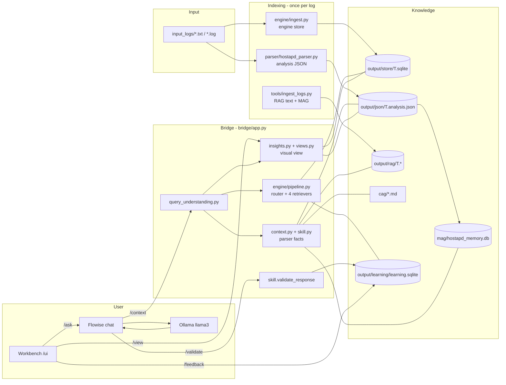
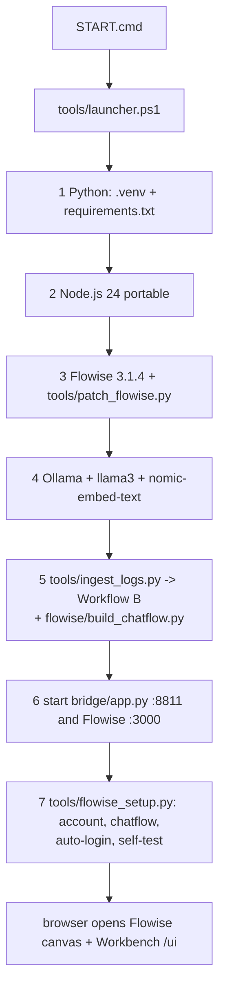
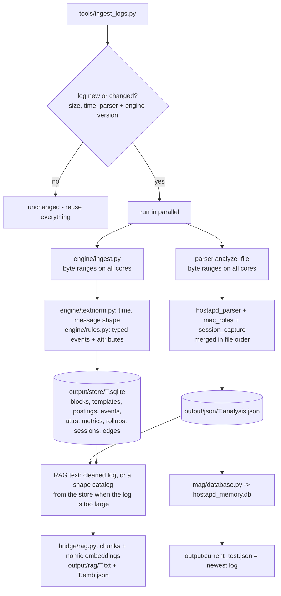
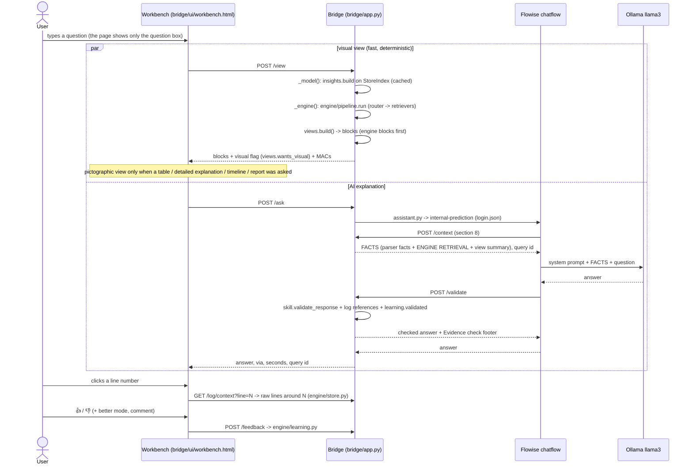
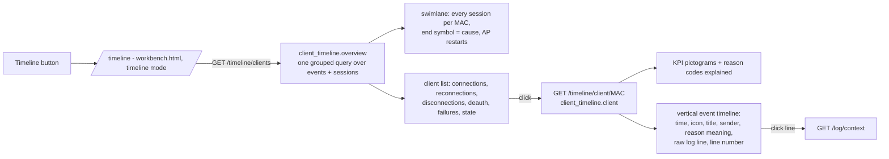
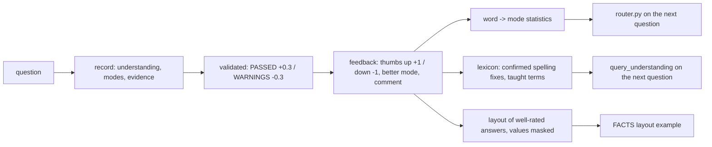

# Hostapd AI Analyzer — Project Report

**Version:** v4.1 (parser 2.10, engine 4.0) · **Date:** 7 Oct 2026
**Project folder:** `C:\Users\Aruneshwaran AR\Documents\hostapd-ai-analyzer`
**Runtime folder:** `%LOCALAPPDATA%\HostapdAIAnalyzer` (Node.js, Flowise, the Flowise database and login)

This report explains **which file does which job** and maps every file onto the **complete workflow**: from
double-clicking `START.cmd`, through indexing a log of up to 10 GB, to answering one question with tables, charts,
an AI explanation, an evidence check and learning from the user's rating.

Contents

1. What the project is
2. The layers and how they connect
3. Folder map
4. Workflow A — start-up (`START.cmd`)
5. Workflow B — indexing a log (ingest)
6. Workflow C — one question in the Workbench
7. Workflow D — one question in the Flowise chat
7a. Workflow E — the Timeline button
8. Inside `POST /context` — how the FACTS are built
9. Inside the v4 engine — store, router, four retrievers, learning
10. The answer check (`POST /validate`)
11. File-by-file reference
12. Data files: who writes them, who reads them
13. HTTP endpoints → code
14. Settings
15. Measured performance
16. Troubleshooting
17. Status

---

## 1. What the project is

The Hostapd AI Analyzer reads OpenWrt **hostapd** logs and AP console captures (PuTTY / serial), and answers
questions about them — "why did client X disconnect?", "summarize all MLO rejections", "what is the channel of
phy00-mld0?", "give an overall report". It runs fully offline on one Windows PC:

| Component | Role | Address |
|---|---|---|
| **Python bridge** (FastAPI) | all analysis: parser, engine, retrieval, views, validator, learning | `http://localhost:8811` |
| **Workbench** (served by the bridge) | question box only; each answer under its question, pictographic when a table / detail is asked; buttons **Full report** and **Timeline**; 👍 / 👎 | `http://localhost:8811/ui`, `/report`, `/timeline` |
| **Flowise 3.1.4** | chat front-end and prompt chain | `http://localhost:3000` |
| **Ollama** | runs the chat model `llama3:latest` and the embedding model `nomic-embed-text` | `http://127.0.0.1:11434` |

### Design rules

1. **The language model never counts, searches or guesses.** Deterministic Python reads the whole log, computes
   every number and selects every evidence line. The model only explains those facts.
2. **Every fact is traceable.** Every table row, finding and cited line carries the hostapd time and the log line
   number; a click opens the raw log around it.
3. **Every answer is checked.** The validator compares the model's text with the evidence and the raw log.
4. **Linear in the log size.** The log is read once (in parallel); later questions use an index, never a re-read.
5. **Learning without retraining.** Every question and rating improves routing, vocabulary and layout; the model's
   weights never change, so a wrong answer can never be "learned".

---

## 2. The layers and how they connect



| Layer | Question it answers | Main files |
|---|---|---|
| **Parser** | "What happened, in exact numbers?" (events, clients, statistics, findings, AP vs client roles) | `parser/*.py` |
| **Engine** (v4.0) | "Where exactly, and what is connected to what?" for logs of any size | `engine/*.py` |
| **RAG** | "Which log lines talk about this?" (keyword + semantic search) | `bridge/log_search.py`, `bridge/rag.py` |
| **MAG** | "Has this happened in earlier tests?" | `mag/*` |
| **CAG** | "What does this Wi-Fi term / reason code mean?" | `cag/*.md` |
| **Skill engine** | "How must the answer be reasoned and checked?" | `bridge/skill.py`, `skills/.../SKILL.md` |
| **Views** | "Show it as tables, charts and a timeline" | `bridge/insights.py`, `bridge/views.py`, `bridge/ui/workbench.html` |
| **Client timeline** | "What happened to this MAC, event by event?" | `bridge/client_timeline.py` |
| **Learning** | "What did users ask and rate, and what should change?" | `engine/learning.py`, `engine/router.py` |

---

## 3. Folder map

```
hostapd-ai-analyzer\
├─ START.cmd / STOP.cmd            one-click start / stop (call tools\launcher.ps1 / tools\stop.ps1)
├─ README.md                       user guide
├─ requirements.txt                Python packages (bridge + tests)
├─ input_logs\                     PUT LOGS HERE - newest file = current test
├─ tools\                          launcher, ingest, Flowise set-up and patches
├─ parser\                         deterministic parser (source of truth for all statistics)
├─ engine\                         v4.0 engine: streaming index, store, 4 retrievers, router, learning
├─ bridge\                         FastAPI service: FACTS, views, validator, Workbench UI
│   └─ ui\workbench.html           the Workbench / report page
├─ flowise\                        chatflow generator + system prompt
├─ mag\                            memory across tests (SQLite)
├─ cag\                            Wi-Fi reference notes for the model
├─ common\                         shared paths and reason-code table
├─ skills\hostapd_analyzer\        SKILL.md (behaviour spec) + IMPLEMENTATION.md (spec -> code)
├─ docs\                           this report, CHANGELOG, ARCHITECTURE_V4, ARCHITECTURE_NOTES
├─ tests\                          73 automated tests + fixture logs
├─ output\                         GENERATED: store, json, rag, learning, current test, ingest state
├─ logs\                           GENERATED: launcher / bridge / Flowise logs, self-test answer
└─ .venv\                          GENERATED: Python environment
```

---

## 4. Workflow A — start-up (`START.cmd` → `tools\launcher.ps1`)



| Step | What happens | Files involved | Typical time |
|---|---|---|---|
| **1 Python** | Finds Python 3.10+ (installs 3.12 with winget if missing), creates `.venv\`, installs `requirements.txt` only when its hash changed. | `requirements.txt`, `bridge\requirements.txt`, `logs\pip_install.log` | first run 1–3 min |
| **2 Node.js** | Downloads portable Node.js 24 (checksum verified) into the runtime folder, or uses an installed Node 24. | runtime `node\` | first run 1–2 min |
| **3 Flowise** | `npm ci` of the pinned Flowise 3.1.4, native SQLite check, copies the auto-login page, applies `patch_flowise.py` (fix for "SQLITE_BUSY: database is locked"). | `tools\flowise_project\`, `tools\flowise_autologin.html`, `tools\patch_flowise.py`, `logs\npm_*.log` | first run 5–15 min |
| **4 Ollama** | Installs / starts `ollama serve`, picks the best installed chat model (8B preferred), pulls `nomic-embed-text`, preloads the chat model. | Ollama | model download once |
| **5 Logs** | Runs `tools\ingest_logs.py` (Workflow B), then `flowise\build_chatflow.py` regenerates the chatflow JSON with the model settings (temperature 0.9, top_p 0.9, top_k 40, repeat penalty 1.1, context 8192). | `input_logs\`, `output\*`, `mag\hostapd_memory.db`, `flowise\hostapd_hybrid_agent.json` | 1 min for 186 MB; ~10–20 min for 10 GB; skipped when unchanged |
| **6 Services** | Writes `run_bridge.cmd` / `run_flowise.cmd`, always restarts the bridge (current code), starts Flowise if needed, waits until both answer. The bridge then **warms up** the current test's views in the background. | runtime `run_*.cmd`, `pids.json`, `logs\bridge.log`, `logs\flowise.log` | seconds; Flowise ~1 min |
| **7 Chatflow** | `tools\flowise_setup.py` creates / signs in the local admin account, creates or updates the chatflow "Hostapd AI Analyzer", stores its id in `login.json`, opens the canvas via the auto-login page, asks one self-test question (`logs\selftest_answer.txt`), then opens the **Workbench**. | `tools\flowise_setup.py`, runtime `flowise_data\login.json` | self-test ~1 min |

`STOP.cmd` → `tools\stop.ps1` stops the bridge (8811) and Flowise (3000) using `pids.json` and the port owners.
Ollama keeps running.

---

## 5. Workflow B — indexing a log (`tools\ingest_logs.py`)



1. **Test ID** = file name upper-cased (`Hostapdtc1.txt` → `HOSTAPDTC1`).
2. **Change check** against `output\ingest_state.json` (size, time, `PARSER_VERSION`, `ENGINE_VERSION`). Logs removed
   from `input_logs\` are removed from MAG, store, JSON and RAG.
3. **Engine store** (`engine\ingest.py`) — one pass; the file is cut into 32 MB byte ranges at line boundaries, one
   worker per core, results merged in file order (at most 2 × workers ranges in memory). Per line: timestamp
   (`engine\textnorm.py`), **message shape** (MACs → `<M>`, numbers → `#`), MAC and shape postings per 2048-line
   block, the template id of every line, and the typed-event rules chosen once per shape (`engine\rules.py`). At the
   end: per-minute rollups, **sessions** (connect → how it ended; AP-restart and capture-boundary aware) and **graph
   edges**. Progress is printed every 10 %.
4. **Parser** (`parser\hostapd_parser.py analyze_file`) — the same byte ranges on all cores: events (classified once
   per message shape), probe statistics, console output for `session_capture.py`, and MAC roles
   (`mac_roles.collect`), merged with `mac_roles.merge` so the result equals one sequential pass.
5. **Save** `output\json\<TEST>.analysis.json`; **MAG** ingest (`mag\database.py`, idempotent).
6. **RAG text** `output\rag\<TEST>.txt` — the cleaned log with `L<line> HH:MM:SS` on every line; if that would exceed
   1.2 MB, a complete **shape catalog** from the store instead (every message shape with first / last occurrence and
   count, plus up to 3 lines per client and per failure / disconnect / AP event type).
7. **Semantic index** (`bridge\rag.py`): 6-line chunks with 3-line overlap, embedded with `nomic-embed-text`
   (lexical-only when Ollama is down) → `output\rag\<TEST>.emb.json`.
8. **Current test** = newest log → `output\current_test.json`.

---

## 6. Workflow C — one question in the Workbench



Each answer is drawn under its question. A plain question shows only the AI answer; a request for a table or a
detailed explanation also shows the pictographic view (KPI tiles with icons, findings, charts, timeline, tables with
event icons), and a named MAC adds that client's timeline (`GET /timeline/client/{mac}`). If the model does not
answer, the answer computed directly from the indexed log is shown.

If Flowise is not reachable, `bridge\assistant.py` builds the same FACTS, calls Ollama directly with the same system
prompt and model settings, and runs the same validator.

---

## 7. Workflow D — one question in the Flowise chat

Chatflow generated by `flowise\build_chatflow.py`:

| # | Node | Job | Calls |
|---|---|---|---|
| 1 | **Context** (Custom JS Function) | sends the question to the bridge; returns the FACTS text ("FACTS UNAVAILABLE … run START.cmd" when the bridge is down) | `POST /context` |
| 2 | **Chat Prompt Template** | `flowise\system_prompt.md` (18 rules) + `FACTS: {facts}` + `QUESTION: {question}` | — |
| 3 | **ChatOllama** | `llama3:latest`, temperature 0.9, top_p 0.9, top_k 40, repeat penalty 1.1, context 8192, keep-alive 60 min | Ollama |
| 4 | **LLM Chain** | prompt + model → text | — |
| 5 | **Response Validator** (ending node) | sends question + answer to the bridge; shows the checked answer, its query number and a link to its visual view | `POST /validate` |

---

## 7a. Workflow E — the Timeline button (`/timeline`)



| Item on the timeline | Source event(s) in the store | What is added |
|---|---|---|
| Connected / Reconnected | `connected` (AP-STA-CONNECTED) | "after N offline"; "no disconnect was logged" for silent reconnects |
| Disconnected | `disconnected` + `sessions` row | how long it was connected, why the session ended (client left, AP kicked it, AP restart, handshake failed) |
| Deauth / disassoc | `deauth_tx/_rx/_local`, `disassoc_tx/_rx`, `disconnect_req`, `unprot` | sent by AP or client, reason code + IEEE meaning + plain-language explanation (a frame without its own code inherits the reason of the request on the lines before) |
| Failures | `auth_no_ack`, `assoc_no_ack`, `fourway_fail`, `sae_fail`, `mlo_reject`, `akm_invalid`, `eap_fail`, `status_fail`, `eapol_noack` | status-code meaning, what usually causes it |
| Link loss / roaming | `inactivity`, `missing_acks` / `reassoc_req`, `btm` | explanation |
| AP events | teardown lines clustered into restarts, DFS, channel switch, broadcast deauth while the client was connected | which interfaces |
| Join steps (off by default) | auth / assoc / EAPOL / 4-way steps | — |

Two to three log lines that describe the same frame are merged into one item (×N). Wi-Fi 7 link addresses are
merged into their MLD client. Cost: one indexed query per client, linear in that client's events.

---

## 8. Inside `POST /context` — how the FACTS are built (`bridge\app.py _context`)

| # | Step | File / function | Output |
|---|---|---|---|
| 1 | Load the analysis (cached by file time) | `app._load_analysis` | analysis JSON |
| 2 | Understand the question: learned vocabulary, spelling fixes, synonyms, MAC notations and partial MACs, loose SSID match, wanted shape (table / list / count / why / timeline), time window, band | `query_understanding.understand`, `engine\learning.lexicon` | rewritten question + "UNDERSTOOD QUESTION" |
| 3 | Classify: query type (report, statistics, client, root cause, history, comparison, knowledge), route (parser / RAG / MAG / CAG), focus MACs | `context.classify` (inside `build_context`) | route |
| 4 | MAG: client history, comparison with an earlier test | `mag\database.py` | history |
| 5 | Keyword RAG over the log (on the store: exact counts at message-shape level) | `log_search.search` / `search_store` | matches, line ranges, example lines |
| 6 | Disconnect episodes and AP restart cycles | `episodes.build`, `episodes.ap_restarts` (on `StoreIndex`) | causes with proof lines |
| 7 | Dashboard-style event table (Deauth / Disassoc / Reassoc / 4-way timeout) | `event_table.build` | rows |
| 8 | Semantic RAG | `rag.search` | chunks |
| 9 | **Engine retrieval** (router → context / graph / agent / wide); the question is recorded with an id | `engine\pipeline.run` | ENGINE RETRIEVAL section, evidence ledger |
| 10 | Summary of the visual view the user sees | `app._view_facts(_view())` | VISUAL VIEW section |
| 11 | Parser FACTS within the budget (`FACTS_BUDGET` 16,000 characters in total) | `context.build_context`, `skill.*` | FACTS |

FACTS sections, in order: UNDERSTOOD QUESTION · QUERY INTENT / DOMAIN / PLAN / EVIDENCE LEVEL (`skill.py`) ·
**COMPUTED ANSWER** with DIRECT ANSWER lines (`context.py`) · STATISTICS · REPORT · LIFECYCLE / TIMELINE · FINDINGS ·
CURRENT LOG EVIDENCE · HISTORICAL MEMORY · TECHNICAL KNOWLEDGE (`cag\`) · MISSING INFORMATION · ANSWER STYLE ·
**ENGINE RETRIEVAL** (modes, COVERAGE, answer lines, agent trace, tables, evidence) · **VISUAL VIEW**.

---

## 9. Inside the v4 engine

### 9.1 The store (`output\store\<TEST>.sqlite`, written by `engine\ingest.py`, read by `engine\store.py`)

| Table | One row per | Used by |
|---|---|---|
| `blocks`, `block_tpl`, `chunk_tpl` | 2048 lines: byte offset, length, times; the template id of every line | random access, `StoreIndex` |
| `templates`, `tpl_blocks`, `tpl_roll` | message shape: text, count, first / last line; its blocks; per-minute counts | keyword search, phrase search, wide retrieval, RAG catalog |
| `macs`, `mac_blocks`, `ent_tpl` | MAC; blocks it appears in; (MAC, shape) counts | entity inventory, device identification, focused search |
| `events` (+ `events_extra`, view `all_events`) | typed event: line, time, type, MAC, peer, interface, reason, status, detail | every retriever |
| `attrs`, `metrics` | value change (channel, frequency, CAC time, SSID, BSSID, AID, firmware, current AP …); per-minute signal | context retrieval, agent |
| `rollup` | (minute, entity, event type) count | wide retrieval |
| `sessions` | client session with end type, reason and cause (station left, DUT kick-out, AP restart, silent reconnect, handshake failed, open) | graph, agent, views |
| `edges` | (client, relation, interface / BSSID) with counts and first / last line | Graph RAG |
| `meta` | totals, timings, coverage statement | every answer |

`StoreIndex` (in `engine\store.py`) gives the older analysis modules (`episodes`, `insights`, `event_table`,
`devices`, `log_search`) the same interface as the in-memory index, but reads only the lines whose message shape can
match — identical results, tested with random substrings of real log lines.

### 9.2 Router and retrievers

| Module | Technique | Triggered by (examples) | Produces |
|---|---|---|---|
| `engine\router.py` | chooses 1–2 modes | wording + entities + learned scores | `modes`, `scores`, `why` |
| `engine\retrieval.py context()` | **Context retrieval** | "what is the channel / signal / AID …", "show line N", "how many … between 11:36 and 11:42", a quoted phrase | exact values with line, exact counts, raw lines |
| `engine\graph.py story()` | **Graph RAG** | "whole story of client X", "everything connected to SSID Y", "who …" | identity, links, join funnel, sessions and causes, restarts, shared-fate clients, relation paths |
| `engine\agent.py investigate()` | **Agentic RAG** | "why …", "root cause", "investigate …" | trace (locate → anchors → before → AP context → co-affected → all-occurrence pattern → recurrence → raw lines) and ranked hypotheses with evidence, side, confidence, how to confirm |
| `engine\retrieval.py wide()` | **Wide retrieval** | "summarize … from top to bottom", "overall", "throughout" | phases in time order, totals, busiest minutes, full shape inventory, COVERAGE |
| `engine\facts.py` | — | — | FACTS text (≤ 4,200 chars), Workbench blocks, evidence ledger |
| `engine\pipeline.py` | entry point | — | runs the above, fills missing times, records the question |

### 9.3 Learning (`engine\learning.py`, `output\learning\learning.sqlite`)



Page: `http://localhost:8811/learning/page` (questions, outcomes, answers to improve, learned vocabulary, "teach a
term"). Delete `output\learning\learning.sqlite` to forget everything.

---

## 10. The answer check (`POST /validate` → `skill.validate_response`)

| Check | What happens |
|---|---|
| MACs | a MAC not in the evidence or the log → `[NOT IN EVIDENCE]` |
| Quoted lines | "line N" must mention the MAC written next to it (read from the store) |
| Values | reason codes, times and numbers not in the evidence are reported |
| Wording | unhedged "caused by" claims are qualified |
| Completeness | `[[TABLE]]` / `[[REPORT]]` placeholders replaced by the exact parser tables; shortened lists completed |
| **Time + line** | missing hostapd time added to "line N"; "Log references" appended when fewer than two (time, line) pairs |
| Footer | Evidence check PASSED / PASSED with adjustments / WARNINGS, query number, link to the visual view |
| Learning | verdict stored as implicit feedback (`learning.validated`) |

---

## 11. File-by-file reference

### 11.1 Root

| File | Responsibility | Workflow |
|---|---|---|
| `START.cmd` | runs `tools\launcher.ps1` (options e.g. `-Temperature 0.3`, `-Lanforge host:port`, `-ChatModel name`) | A |
| `STOP.cmd` | runs `tools\stop.ps1` | A |
| `README.md` | user guide: one click, example questions, engine, Workbench, options, troubleshooting | — |
| `requirements.txt` | bridge requirements + httpx + pytest | A1 |
| `PROJECT_WORKFLOW.txt` | earlier workflow notes (v3.x) | — |
| `.gitignore` | keeps `.venv`, `logs`, `output`, databases and Node modules out of version control | — |

### 11.2 `tools\` — start-up, indexing, Flowise

| File | Responsibility | Called by | Writes |
|---|---|---|---|
| `launcher.ps1` | the 7-step launcher (section 4), progress output, `logs\launcher.log` | `START.cmd` | runtime folder, `.venv` |
| `stop.ps1` | stops bridge and Flowise | `STOP.cmd` | — |
| `ingest_logs.py` | Workflow B: change check, engine + parser in parallel, RAG text / shape catalog, MAG, current test | launcher step 5 | `output\store`, `output\json`, `output\rag`, `output\current_test.json`, `output\ingest_state.json` |
| `flowise_setup.py` | Flowise account + sign-in, create / update chatflow, `chatflow_id` + canvas URL in `login.json`, `--selftest` | launcher step 7 | runtime `login.json`, `logs\selftest_answer.txt` |
| `flowise_autologin.html` | page copied into Flowise that signs the browser in and opens the canvas | launcher step 3 | — |
| `patch_flowise.py` | idempotent Flowise patches (sign-in queue, SQLite busy timeout) | launcher step 3 | Flowise install |
| `ollama_watchdog.ps1` | optional: keeps Ollama running, CPU-only mode | manual | — |
| `validate_agent.py` | diagnostic for the earlier tool-agent design | manual | — |
| `flowise_project\` | pinned `package.json` + lockfile for Flowise 3.1.4 | launcher step 3 | — |
| `flowise_data\` | legacy Flowise data of the first version (live data is in the runtime folder) | — | — |

### 11.3 `parser\` — deterministic statistics (source of truth for counts)

| File | Responsibility | Key functions |
|---|---|---|
| `hostapd_parser.py` | event patterns (auth, assoc, 4-way, SAE, EAP, deauth / disassoc and who sent them, disconnect requests, unprotected deauth under PMF, link loss, driver errors), MAC attribution for SAE / EAPOL lines, per-client summaries, statistics, findings, reason meanings; streamed and parallel parsing (`PARSER_VERSION = "2.10"`) | `analyze(text)`, `analyze_file(path)`, `analyze_file_parallel`, `_scan`, `_classify` (cached per message shape), `split_lines`, `iter_file_lines` |
| `mac_roles.py` | AP vs client: BSSIDs from BSS setup, MLD lines, frames the AP sends; clients = MACs that sent auth / assoc requests; neighbour BSSIDs, bands, AP MLD addresses, client SSIDs / BSSIDs / signal / final state, Wi-Fi 7 link → MLD merge | `collect` (streamable, `pending` items for parallel ranges), `merge`, `finish`, `classify` |
| `session_capture.py` | console captures: `iw dev`, `iw station dump`, `ping`, probe requests / responses | `parse_session`, `ProbeStats`, `latest_station_view`, `rf_findings` |
| `generate_sample_log.py` | synthetic log for testing without a capture | — |

### 11.4 `engine\` — v4.0 production engine

| File | Responsibility | Key functions |
|---|---|---|
| `__init__.py` | package description, `ENGINE_VERSION = "4.0"` | — |
| `textnorm.py` | timestamp formats (logread, syslog, ISO, `hostapd -t`), message body, message shape (template) | `parse_prefix`, `body_of`, `template` |
| `rules.py` | typed event + attribute extraction from one line; rules chosen once per shape; event labels and families (disconnect / failure / AP) | `rules_for_template`, `r_*` rule functions |
| `ingest.py` | one parallel pass → store; sessions; edges; `python -m engine.ingest <log> --test-id X` | `ingest`, `process_chunk`, `chunk_ranges`, `build_sessions` |
| `store.py` | open the store, random access to any line, block cache, postings, `StoreIndex` drop-in | `open_store`, `Store.line / lines / q / positions`, `StoreIndex.candidates / raw_candidates / contains`, `anchor_of` |
| `retrieval.py` | **context** and **wide** retrieval, entity resolution, event-type vocabulary, exact counts, evidence references | `context`, `wide`, `resolve`, `types_in`, `count_events` |
| `graph.py` | **Graph RAG**: entity graph and stories, relation paths | `Graph.story_client / story_ap / story_events / path`, `story` |
| `agent.py` | **Agentic RAG**: bounded investigator with trace, base-rate corrected co-occurrence, all-occurrence pattern check, hypotheses | `investigate` |
| `router.py` | question → modes (rules + learned) | `route` |
| `learning.py` | query memory, implicit + explicit feedback, routing statistics, lexicon, layout examples, statistics page data | `record`, `validated`, `feedback`, `mode_scores`, `lexicon`, `style_example`, `stats` |
| `facts.py` | results → FACTS text, Workbench blocks, evidence ledger | `render`, `blocks`, `refs` |
| `pipeline.py` | single entry point used by the bridge | `run` |

### 11.5 `bridge\` — the service (FastAPI, `127.0.0.1:8811`)

| File | Responsibility | Workflow |
|---|---|---|
| `app.py` | HTTP API (section 13); `_context` (FACTS), `_validate`, `_engine`, `_view`, `_model`, `_store` / `_index` (disk index, in-memory only for small logs), streamed `/parse`, analysis cache, background warm-up | C, D |
| `query_understanding.py` | spelling, synonyms, learned vocabulary, MAC notations, partial MACs, SSID match, wanted shape, time window, band | C, D |
| `context.py` | query classifier and FACTS builder: DIRECT ANSWER builders (SSIDs, clients per SSID / band, deauth list, failures, restarts, unknown MAC, reason codes), statistics, report, timeline, findings, evidence, CAG selection, answer styles, size cap | D |
| `skill.py` | runtime skill engine (implements `SKILL.md`): intents, domains, plans, lifecycle, timeline, typed findings, evidence level, missing information, final JSON report, **response validator**, log-reference enforcement | D |
| `log_search.py` | keyword RAG: question words → keyword groups → matches; in-memory `LogIndex` for small logs, `search_store` on the engine store | D |
| `rag.py` | semantic RAG: chunking, Ollama embeddings, cosine + exact-match scoring | B, D |
| `episodes.py` | disconnect episodes per client with cause and proof line; AP restart / reconfiguration cycles | C, D |
| `event_table.py` | dashboard-style event table (as the test-suite helper `analyze_hostapd_logs`), LANforge enrichment, HTML report | C, D |
| `insights.py` | visual analysis model: captures (firmware, operator actions), sessions with band, disconnects with initiator, join failures, per-client counters, ranked findings with evidence, KPIs | C |
| `devices.py` | device identification from frame hexdumps (WPS model, vendor elements, MAC vendor prefix, Wi-Fi 7) | C |
| `views.py` | question → view blocks (KPIs, findings, bar / stacked / grouped charts, timeline, comparison, tables with Time + Line); `wants_visual()` decides whether the Workbench shows them | C |
| `client_timeline.py` | **Timeline button**: per-client events from the engine store - connected / reconnected (time offline) / disconnected (session length, cause) / deauth & disassoc (sender, reason code, meaning, explanation) / failures (status meaning) / link loss / roaming / AP restarts; all-client swimlane; CSV | E |
| `assistant.py` | Workbench AI call: Flowise internal-prediction (signed in with `login.json`), fallback to Ollama | C |
| `ui\workbench.html` | one page, three modes: Workbench `/ui` (question box only, answers under each question, pictograms), Full report `/report`, Timeline `/timeline` (swimlane, client list, event timeline with reason explanations); raw-log viewer, sortable tables, CSV, 👍 / 👎, light / dark, print | C, E |
| `requirements.txt` | fastapi, uvicorn, python-multipart | A1 |

### 11.6 `flowise\` — chatflow

| File | Responsibility |
|---|---|
| `build_chatflow.py` | generates the chatflow (Context → Prompt → ChatOllama → LLM Chain → Response Validator) with the model settings |
| `system_prompt.md` | 18 rules: evidence first, exact counts from the parser, history is not evidence, correlation ≠ causation, AP vs client, copy DIRECT ANSWERs completely, mandatory (time, line), how to use each engine mode, no code; format examples |
| `hostapd_hybrid_agent.json` | the generated chatflow (rebuilt on every START) |
| `build_agent_chatflow.py`, `agent_system_prompt.md` | legacy tool-agent design, not used by START |

### 11.7 `mag\`, `cag\`, `common\`, `skills\`, `docs\`

| File | Responsibility |
|---|---|
| `mag\schema.sql` | MAG tables: tests, clients, test_clients, events, issues, findings, reason_codes |
| `mag\database.py` | idempotent ingest, client history, list / delete tests, compare tests, top unstable clients, findings history |
| `cag\01 … 09_*.md` | reference notes: client lifecycle, authentication / association, WPA / EAPOL, deauth / disassoc reason codes, roaming / 802.11k/v/r / MLO, config + QA method, driver / platform errors, RF station metrics, AP bring-up / MLD |
| `common\paths.py` | runtime folder, Flowise data / login file, current-test file |
| `common\reason_codes.py` | IEEE 802.11 reason-code meanings and plain-language explanations, benign / security codes, status-code meanings |
| `skills\hostapd_analyzer\SKILL.md` | behaviour specification (evidence first, anti-hallucination, report format, validator) |
| `skills\hostapd_analyzer\IMPLEMENTATION.md` | map from each SKILL section to the code |
| `docs\ARCHITECTURE_V4.md` | engine design, data model, complexity, benchmark, limits |
| `docs\CHANGELOG.md` | version history v1 … v4.0 |
| `docs\ARCHITECTURE_NOTES.md` | review of the original CAG + RAG + MAG architecture document |
| `docs\PROJECT_REPORT.md` | this report |

### 11.8 `tests\` — 73 automated tests (`.venv\Scripts\python -m pytest -q`)

| File | Covers |
|---|---|
| `test_parser.py`, `test_mac_roles.py` | parser events, statistics, findings; AP vs client roles |
| `test_context.py`, `test_skill.py` | query classification, computed answers, skill intents, lifecycle, validator |
| `test_bridge.py`, `test_mag.py` | HTTP endpoints, memory ingest and history |
| `test_v33.py`, `test_v34.py` | AP MLD, neighbour BSS, reason 15, SAE attribution, episodes, restarts; understanding, RAG chunks, event table, completeness guard |
| `test_v35.py` | insights, view routing, Time + Line in every table, mandatory log references, Workbench endpoints |
| `test_v40.py` | random access, CRLF / lone-CR numbering, parallel = sequential (engine and parser), `StoreIndex` = memory index (incl. random substrings), keyword search and devices on the store, router, all four retrievers with evidence read back, learning loop, engine endpoints |
| `test_v41.py` | visual-on-request rule, reason / status explanations, `/view` flags, Timeline pages, client list, client timeline order, connected / reconnected titles, kind filter, CSV, LOG-TRIGGER MAC-role regression |
| `fixtures\` | real-log excerpts: `final_excerpt.txt`, `frames_dd.txt`, `hostapd204_openwrt.txt`, `insights_excerpt.txt`, `session_capture_excerpt.txt` |

### 11.9 Runtime folder `%LOCALAPPDATA%\HostapdAIAnalyzer`

| Item | Responsibility |
|---|---|
| `node\` | portable Node.js 24 |
| `flowise\node_modules\` | Flowise 3.1.4 (patched) |
| `flowise_data\` | Flowise database, keys, `login.json` (local admin, canvas URL, chatflow id) |
| `run_bridge.cmd`, `run_flowise.cmd`, `pids.json` | background wrappers and process ids |

---

## 12. Data files: who writes them, who reads them

| File | Written by | Read by |
|---|---|---|
| `input_logs\<log>` | you | `engine\ingest.py`, parser, `engine\store.py` (random access), `/log/context` |
| `output\store\<T>.sqlite` | `engine\ingest.py` | `engine\store.py` → retrievers, `StoreIndex`, `/view`, `/context`, `/log/context` |
| `output\json\<T>.analysis.json` | `tools\ingest_logs.py` / `/parse` (parser) | `app._load_analysis` → context, views, graph, MAG |
| `output\json\<T>.insights.json` | `app._model` | `views.compare_tests` (test vs test) |
| `output\rag\<T>.txt`, `.emb.json` | `ingest_logs.py`, `rag.build_index` | `rag.search` |
| `output\learning\learning.sqlite` | `engine\learning.py` (`/context`, `/validate`, `/ask`, `/feedback`) | router, understanding, `/learning` |
| `output\current_test.json`, `ingest_state.json` | `ingest_logs.py` | `app._resolve_test_id`, `ingest_logs.py` |
| `mag\hostapd_memory.db` | `mag\database.py` | `/context` (history, compare), `/mag/*` |
| `flowise\hostapd_hybrid_agent.json` | `build_chatflow.py` | `flowise_setup.py` → Flowise |
| `logs\*.log`, `logs\selftest_answer.txt` | launcher, bridge, Flowise, `flowise_setup.py` | you (troubleshooting) |

---

## 13. HTTP endpoints → code (`bridge\app.py`)

| Endpoint | Purpose | Main code |
|---|---|---|
| `POST /context`, `GET /context?q=` | FACTS for a question (Flowise Context node) | `_context` → understanding, context.py, MAG, RAG, episodes, event table, engine, view |
| `POST /validate` | answer check (Flowise Validator node) | `_validate` → `skill.validate_response`, learning |
| `GET /ui`, `GET /report`, `GET /timeline` | Workbench / full visual report / client timeline page | `ui\workbench.html` |
| `GET /timeline/clients` | all clients: counters, sessions for the swimlane, AP restart markers | `client_timeline.overview` |
| `GET /timeline/client/{mac}` (`kinds`, `offset`, `limit`), `/csv` | one client's event timeline with reason / status meanings | `client_timeline.client` |
| `POST /view`, `GET /view?q=` | visual view for a question | `_view` → insights, views, engine blocks |
| `POST /ask` | AI answer for the Workbench | `assistant.ask` → Flowise or Ollama |
| `GET /log/context?line=N` | raw log around a line | `engine\store.py` / `LogIndex` |
| `POST /feedback` | 👍 / 👎, better mode, comment | `learning.feedback` |
| `GET /learning`, `GET /learning/page`, `POST /learning/synonym` | learning statistics, page, teach a term | `engine\learning.py` |
| `GET /engine/status`, `GET /engine/retrieve?q=&mode=` | store metadata; run the retrievers directly | `engine\store.py`, `engine\pipeline.py` |
| `POST /parse` | upload a log (streamed to disk, parsed, indexed) | `analyze_file`, `engine.ingest` |
| `GET /report/events`, `/report/events.json` | dashboard-style event table | `event_table.py` |
| `GET /tests`, `/analysis/{id}` (+ `/full`, `/rf`, `/infrastructure`, `/client/{mac}`, `/search`), `/skill/report` | parsed data and the standard JSON report | parser JSON, `skill.final_report` |
| `/mag/client/{mac}`, `/mag/test/{id}` (GET / DELETE), `/mag/top-unstable`, `/mag/findings/{id}`, `/mag/compare` | memory across tests | `mag\database.py` |
| `/cag`, `/cag/topics`, `/reason-codes/{code}` | knowledge notes, reason codes | `cag\`, `common\reason_codes.py` |
| `/local/flowise-login` | local sign-in data for the auto-login page | `common\paths.py` |
| `GET /health`, `GET /`, `GET /docs` | status, upload page, API documentation | FastAPI |

---

## 14. Settings

| Setting | Where | Default | Effect |
|---|---|---|---|
| `-Temperature`, `-ChatModel`, `-Lanforge` | `START.cmd` options | 0.9, best 8B model, none | model settings; LANforge IP / client names in event tables |
| `ENGINE_CHUNK_MB`, `ENGINE_WORKERS` | environment | 32, 8 | engine byte-range size and worker count |
| `PARSER_WORKERS` | environment | 6 | parser worker count |
| `FACTS_BUDGET` | environment | 16000 | maximum FACTS characters (llama3 8K window) |
| `LOGINDEX_MAX_MB` | environment | 600 | largest log the in-memory index may load when no store exists |
| `RAG_CHUNK_LINES / _CHARS / _OVERLAP` | environment | 6 / 480 / 3 | semantic RAG chunking |
| `BRIDGE_WARMUP` | environment | 1 | build the current test's views in the background at start |

---

## 15. Measured performance

| Measurement | Result |
|---|---|
| Your PC, `HostapdsamsungM04wifi7.txt` (186 MB, 1.29 M lines), START step 5 | engine 9 s, parser 14 s, whole ingest incl. embeddings 54 s; self-test answer 65 s |
| Your log `Hostapdtc1.txt` (951 MB, 5.9 M lines, 72 clients), Linux VM on your PC | engine 51 s, parser 86 s; questions 40–260 ms |
| Sandbox, 2 vCPU: 1× / 2× / 4× / 8× the 186 MB log | engine 6 / 12 / 23 / 53 s, parser 17 / 34 / 70 / 140 s — linear, memory flat |
| Sandbox, **10 GB** (62 M lines) | engine 6 min 37 s, store 84 MB; full ingest 20 min on 2 vCPU (est. 5–10 min on 4–8 cores); peak memory 1.15 GB; questions 0.02–0.25 s |

Details: `docs\ARCHITECTURE_V4.md`.

---

## 16. Troubleshooting

| Symptom | Fix |
|---|---|
| "FACTS UNAVAILABLE" | bridge not running → `STOP.cmd`, `START.cmd`; see `logs\bridge.log` |
| "SQLITE_BUSY: database is locked" on the Flowise sign-in page | `STOP.cmd`, `START.cmd` (patch + automatic restart) |
| Old behaviour after an update | restart: `STOP.cmd` → `START.cmd` (re-index runs when parser or engine version changed) |
| First question on a large log is slow | the background warm-up is still running (≈ 35 s per 10 GB); later questions take < 1 s for the views |
| "engine store is missing or out of date" (HTTP 503) | run `START.cmd` (or `tools\ingest_logs.py`) to index the log |
| See exactly what the model received | `http://localhost:8811/context?q=<question>` |
| See what the engine retrieved | `http://localhost:8811/engine/retrieve?q=<question>` |
| A new log is not used | put it in `input_logs\` (newest = current test), run `START.cmd` |

---

## 17. Status (7 Oct 2026)

- **v4.1**: Workbench shows only the question box; answers appear under each question, pictographic when a table
  or a detailed explanation is asked; Full report button kept; new **Timeline** button with every client MAC's
  connections, reconnections, disconnections, deauth / disassoc with reason-code explanations, failures and AP
  restarts (section 7a). Parser 2.10 fixes a phone being listed as an AP (HOSTAPD-LOG-TRIGGER addr=).

- **v4.0 deployed and running on your PC**: START indexed `HostapdsamsungM04wifi7.txt` with the engine store, the
  self-test passed and the Workbench answered through the Flowise chatflow; the first questions are in the query
  memory.
- v4.0: logs up to 10 GB in linear time, five techniques (query learning, context retrieval, Graph RAG, Agentic RAG,
  wide retrieval), identical legacy results on the disk index, parser 2.9 ("disassocation" spelling).
- v3.5: Workbench with tables, charts, timeline, comparisons; mandatory time + line references.
- v3.4: question understanding, dashboard-style event table, smaller RAG chunks, temperature 0.9.
- Known limits: event types come from explicit rules (unknown messages are still indexed and searchable); llama3 8B
  has an 8K-token window (FACTS are budgeted, full tables are in the Workbench); learning adapts routing,
  vocabulary and layout but does not retrain the model.
